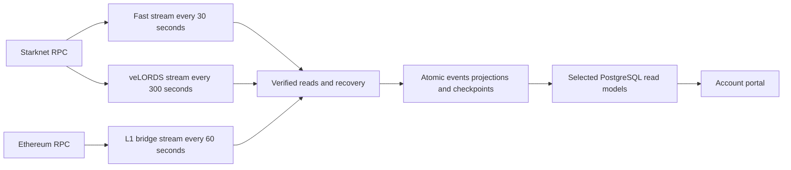

# Direct RPC indexer migration plan

Status: proposed implementation plan, 29 October 2026. Repository baseline: `1227d40b3918e8e49e5011f892e44c336aeab56a`. Ekubo source reviewed at [`d09e515351db44486845bf0a79b882828f41c67f`](https://github.com/EkuboProtocol/indexer/tree/d09e515351db44486845bf0a79b882828f41c67f), committed 28 October 2026.

Replace the deployed Starknet Apibara workloads with one TypeScript RPC worker, then migrate the Ethereum bridge from HyperIndex to the same package. Keep separate durable checkpoints for workloads with different polling intervals. Rebuild into isolated PostgreSQL schemas and switch application readers individually after comparison. Retain the old indexers during the rollback period.

The recommended initial intervals are 30 seconds for Starknet ownership, claims and bridge events, five minutes for veLORDS history, and 60 seconds for the Ethereum bridge. Persist accepted blocks with hashes; pending/preconfirmed updates are outside the first implementation. This changes visibility latency and must be verified in the bridge and ownership UI before cutover.

The implementation should adapt Ekubo's transport and recovery mechanisms, while using storage and projections designed for this repository. A simple `getEvents` loop does not replace the rollback behavior currently supplied by Apibara and HyperIndex.

This change is a plan only. No new worker, schema, reader selection or deployment is applied by it. Source and tests were inspected; Ekubo's test suite was not executed, and Alchemy capabilities and resource consumption have not been measured for the proposed worker.

## Scope and current consumers

Deployment observations below refer to the Railway inspection on 28 October, recorded in [the cost investigation](./apibara-railway-costs.md). Recheck live services and portal environment selections before implementation cutover. A repository default does not establish the deployed reader selection.

| Workload                  | Current source and destination                                                     | Target stream                                                  | Initial interval |
| ------------------------- | ---------------------------------------------------------------------------------- | -------------------------------------------------------------- | ---------------- |
| Realm ownership           | Apibara `strk-realms-ownership`; mutable owner table and progress                  | `starknet-fast`                                                | 30 s             |
| Realm LORDS claims        | Apibara `strk-realms-lords-claims`; service was stopped on a Drizzle schema error  | `starknet-fast`, sharing the Realms contract query             | 30 s             |
| Starknet bridge           | Legacy Apibara bridge plus isolated L2 shadow                                      | `starknet-fast`; one ingestion feeds the new bridge projection | 30 s             |
| veLORDS locks and rewards | Apibara `strk-velords`; two contracts and two history tables                       | `starknet-velords`                                             | 300 s            |
| Ethereum bridge           | HyperIndex shadow using HyperSync; legacy Apibara implementation remains in source | `ethereum-bridge`, migrated last                               | 60 s             |
| Delegates                 | Commented indexer and stopped service                                              | Remains disabled                                               | None             |
| Burner transfers          | Source exists, but no active service was identified                                | Remains disabled unless separately enabled                     | None             |

The burner indexer is not ready to activate as a migration side effect: it reuses the claims indexer name, specifies an absent `_id` column, and its configured mainnet burner address contains whitespace. Its correctness and product need are a separate decision. The active veLORDS burns reader currently uses reward-received history.

Preserve the existing sources of contract addresses in [constants](../packages/constants/src/contracts.ts) and [bridge routes](../packages/bridge/src/index.ts). The four active Starknet addresses are Realms, Realms bridge, veLORDS, and reward pool. Ethereum uses the Starknet messaging contract with the existing Realms route filters.

| Data                 | Mainnet starting boundary                               | Sepolia starting boundary                             |
| -------------------- | ------------------------------------------------------- | ----------------------------------------------------- |
| Ownership            | Existing cursor `664161`, first intended block `664162` | Existing cursor `0`                                   |
| L2 bridge and claims | Existing cursor `664161`, first intended block `664162` | Existing cursor `76103`, first intended block `76104` |
| veLORDS              | Existing cursor `699904`, first intended block `699905` | Existing cursor `76103`, first intended block `76104` |
| L1 bridge            | Inclusive block `20433152`                              | Inclusive block `6180467`                             |

Express the new configuration as an inclusive first block and test the translation from each legacy boundary. Test the Sepolia ownership block-zero edge explicitly rather than deriving it from an ambiguous cursor name. A group starts at its earliest enabled filter, but each filter retains its own lower bound.

The principal reader paths are:

- [Ownership inventory](../packages/db/src/realm-ownership.ts): joins immutable metadata, exposes `ready`, `syncing`, `stale` and `unavailable`; freshness currently uses a ten-minute chain-time window. The UI polls every 15 seconds.
- [Bridge history](../apps/account-portal/src/lib/getBridgeTransactions.ts): polls every ten seconds. Its isolated path combines both chains in one SQL snapshot and uses [five-minute freshness and L1 lag checks](../apps/account-portal/src/lib/bridge-history.ts).
- [veLORDS analytics](../apps/account-portal/src/lib/getVeLordsAnalytics.ts) and [burn history](../apps/account-portal/src/lib/getVeLordsBurns.ts): consume exact integer amounts and timestamps from reward/lock history.
- [Claims history](../apps/account-portal/src/lib/getRealmsLordsClaims.ts): filters by recipient and orders by time. Keep its return shape and establish historical completeness independently of the stopped worker.

The existing [L1 migration plan](./l1-hyperindex-railway-migration-plan.md) remains the runbook for the deployed HyperIndex and Apibara shadows until their individual cutovers. Do not reset their schemas or transplant their checkpoint metadata.

## What Ekubo actually implemented

### Transport and filtering

Ekubo's [Starknet adapter][E1] uses `starknet_getBlockWithTxHashes` for head, numbered block and `l1_accepted` reads. It queries `starknet_getEvents` over bounded ranges, pins the end to a block hash, follows continuation tokens, and rejects repeated tokens, conflicting block hashes, duplicate positions and events outside the requested range. Defaults are 1,000 events per page and 200 pages before refusing the range. It sorts by transaction index, then event index, and fetches timestamps once per fresh event-bearing block.

Its event query sends a union of selectors without an address restriction, then applies exact address/key filters locally. That can reduce requests for Ekubo's selectors. Copying that query for our common `Transfer` selector would fetch unrelated contracts across Starknet. Our query planner must restrict addresses.

Its [Ethereum adapter][E2] reads logs for configured addresses and filters topics locally. It rejects removed logs in a numbered range and splits a range when the returned count exactly equals the configured suspected result cap. It can use log-provided timestamps and otherwise completes block headers. This is a useful model for bounded reads, but provider-specific range/cap behavior still requires validation.

### Consistent reads before emitting data

The shared [snapshot reader][E3] obtains a range-end anchor, fetches all events, completes their headers, then rereads the persisted cursor block and range-end block. A changed range-end hash invalidates the whole read before emission. A changed cursor triggers recovery. Header and event hashes must agree, including when the range contains no relevant events.

One endpoint supplies a complete read cycle. Ekubo now has an EVM endpoint selector, but it changes endpoints between cycles; it does not mix providers inside a snapshot. Starknet configuration still requires one URL. Start our worker with one explicitly configured endpoint per chain. Add failover only with a tested restart of the entire read cycle.

### Reorg detection, restart recovery and finality

The [stream engine][E4] rereads a window anchored below its own processed cursor. Anchoring below the current chain head would skip the vulnerable interval after a long sleep. The window is time-based, converted using observed block production, and capped at half the maximum range so each successful catch-up read can make progress.

Within that window, Ekubo compares event-bearing block hashes and event counts. A cursor-hash mismatch can also cause a search through [persisted history][E5] for a common canonical checkpoint outside the window. An unavailable block is a failed verification, not evidence that history should be deleted.

On restart, it compares the initial RPC window with stored event-bearing blocks. This repairs a specific gap: the node once returned incomplete events, the worker advanced its cursor, and the process restarted before the next reread. A canonical cursor hash alone does not prove that every event beneath it was stored. The [tests][E6] reproduce that failure and exercise recovery through lagging reads and restarts.

Newly observed finality remains pending until the previous window is reconciled and the relevant data has been indexed. It must not move the reread floor early and hide a reorg. Persisted finality is different from the endpoint's current finality. [Rollback guards][E7] stop destructive recovery when previously verified finalized history no longer matches or a configured depth limit is exceeded.

### Persistence and process behavior

Ekubo's [runtime][E8] writes block events and the cursor inside one database transaction. Its [DAO][E9] uses an expected-cursor condition to reject conflicting updates. Rollback deletes blocks and cascades to their event tables; application-specific projections must also be restored correctly.

Empty blocks do not each get a permanent block row. A synthetic eventless tail advances the durable cursor and chain-time metadata. This distinction matters for our quiet bridge and ownership contracts: a worker heartbeat is not evidence that it has indexed the chain head.

The DAO holds a session advisory lock through a single PostgreSQL connection and polls `pg_try_advisory_lock` instead of waiting inside a blocking SQL statement. Connection loss terminates its worker. Our implementation should keep lock ownership and writes on the same session and test loss of that session.

The RPC client handles timeouts, transient HTTP failures, and retryable JSON-RPC errors even when HTTP status is 200. The outer loop backs off through outages and caps subsequent range ends at a previously failed height to avoid endlessly chasing a head whose event index is behind. It eventually exits on sustained failure. Quiet polls back off, with the ceiling constrained by how many blocks one range can drain; finality polling also slows with the workload.

### What to adapt and what to change

| Ekubo mechanism                                     | Decision for this repository                                                                                |
| --------------------------------------------------- | ----------------------------------------------------------------------------------------------------------- |
| Chain adapters and common recovery engine           | Adapt the protocol and invariant tests; both Starknet and EVM are real consumers                            |
| Snapshot verification and cursor-anchored overlap   | Required from the first shadow implementation                                                               |
| Restart comparison with durable history             | Required; strengthen comparison to event identities/content digests, not only block presence                |
| Broad Starknet selector query                       | Replace with address-scoped query groups                                                                    |
| One cursor per chain/process                        | Use one cursor per polling group; slow queries must not inherit fast-stream progress                        |
| Event-derived state and transactional cursor        | Adopt with our own raw events and projections                                                               |
| Packed numeric event IDs and 16-bit position limits | Do not adopt; those constraints belong to Ekubo's database                                                  |
| Implicit changes to configured filters              | Reject configuration-fingerprint changes until an explicit replay/migration is selected                     |
| Retry by matching a legacy exception string         | Do not carry into the new runtime; use typed failure outcomes                                               |
| Runtime coverage                                    | Add end-to-end runtime/crash tests; the upstream runtime itself notes a coverage gap                        |
| MIT-licensed source reuse                           | Preserve copyright/license text for any copied or substantially adapted code and record the pinned revision |

Ekubo's [verification script][E10] compares historical swap positions against its database. Its README reports a wider migration validation, but that script alone checks one event family. Our parity tool must cover every enabled event family and the resulting application projections.

## Two compatibility findings that affect the design

### Starknet event positions are not interchangeable

Our pinned `@apibara/starknet@2.1.0-beta.54` codec documents `eventIndex` as the position in the block and exposes a separate `eventIndexInTransaction`. Our ownership and isolated bridge handlers use `event.eventIndex`. The [DNA protocol][A1] also exposes both fields. By contrast, RPC v0.10 `event_index` is transaction-local, alongside `transaction_index`; see the [official specification][S1]. Ekubo's compatibility claim describes its own older database and cannot establish compatibility with ours.

Use explicit position fields in the new model:

- Starknet: `transaction_index` and `event_index_in_transaction`.
- Ethereum: `transaction_index` and block-wide `log_index`.
- Shared event identity: chain ID, block hash, transaction hash, and the chain's event position. Keep the position kind explicit.

Never derive an event position from the filtered result array or default a missing position to zero. Verify positions against complete transaction receipts for selected historical fixtures. Missing mandatory positions should fail the capability check; a receipt-based compatibility adapter is a separate fallback implementation, not an automatic silent downgrade.

New Starknet physical event IDs may differ from existing IDs. That is acceptable in an isolated replay if parity compares normalized chain evidence and the logical bridge request key remains stable. Update bridge sorting to use transaction index plus transaction-local event index for RPC Starknet rows. Do not put transaction-local indices into the current `log_index` sort without adapting it. Legacy and HyperIndex adapters can retain block-wide ordering. The ownership projection must apply transfers in full canonical order, including multiple transactions affecting the same token in one block.

### Multi-address queries need a capability test

The official v0.10.0 event filter accepts one address; [v0.10.1][S2] and [v0.10.2][S1] accept an address or address list. Alchemy's [network list][A2] supplies `v0_10` endpoints, while an older FAQ still recommends v0.9. Do not infer support for every patch-level feature from the URL.

Probe `starknet_specVersion`, chain ID, real event positions, hash-bounded pagination and address-list results. Compare an address-list query with the union of the equivalent individual queries over the same settled, hash-checked range. Enable it only when they agree. Persist the selected capability mode with the deployment configuration.

Without address-list support, use individual address queries and combine them before committing the group. Never fall back to an unrestricted chain-wide `Transfer` scan. With address lists, union the allowed selectors and still check each address/selector pair locally, since the server filter is a cross-product superset.

## Target architecture

Add `packages/rpc-indexer`, package name `@realms-world/rpc-indexer`. Use the existing TypeScript, `pg`, Drizzle, Starknet and viem dependencies where appropriate; pin tested versions. Build a standalone Node entrypoint. Use the existing Node 22 indexer CI pattern and a supported pinned Node image for deployment, without changing the frontend runtime as part of this migration.



Run one worker per environment initially, with independent stream loops and a bounded RPC request pool. Serialize database commits on the session holding the writer lock. A slow RPC request must not hold a database transaction or prevent another stream from fetching. A failed stream stops its own progress and reports degraded readiness; lock loss or a database integrity failure stops all writes.

The two Starknet groups are:

1. `starknet-fast`: ownership and claims on the Realms contract, plus both Realms bridge events. All queries share one group checkpoint, so a poll only commits when every filter's range is complete.
2. `starknet-velords`: `ModifyLock` and `RewardReceived`, with its own slower checkpoint and recovery history.

The Ethereum bridge is a third group. Share identical head/header reads within a scheduling cycle where safe, but never share a completed cursor between groups. Cache immutable headers by chain and hash; a numbered header used to prove canonicality must be freshly validated. Clear cycle caches when changing endpoint or abandoning a snapshot.

A shared end validation must happen after all reads it certifies. If the slow group is catching up to a different height, misses that cycle, or exceeds its time budget, give it its own anchor reads and account for the extra calls. Do not reuse a fast group's earlier end check to certify later slow-group data. The fast group's shared checkpoint also deliberately couples its domains: a malformed claims event blocks that group's ownership and bridge advance until resolved. Split it into additional streams only if operational evidence justifies the extra checkpoints and reads.

Use three modules with small interfaces:

| Module           | Interface and responsibility                                                                                                                                                       |
| ---------------- | ---------------------------------------------------------------------------------------------------------------------------------------------------------------------------------- |
| Chain reader     | Reads head/finality, verifies a numbered block, and returns a complete bounded event range. Starknet and EVM adapters hide pagination, serialization and provider-specific errors. |
| Stream processor | Runs one configured group, verifies/reconciles reads, and proposes an atomic advance or rewind. Owns scheduling, retries and correctness rules.                                    |
| PostgreSQL store | Loads recovery state and commits an advance/rewind with expected cursor and generation. Owns events, projections, locking and progress in one transaction.                         |

Handlers receive decoded events with explicit chain position and return projection changes or execute through the transaction-scoped store. They must not initialize clients, read global environment variables, issue external RPC calls or write outside the store transaction.

Suggested package layout:

```text
packages/rpc-indexer/
  src/config.ts                 # validated network, filters, schema, limits
  src/main.ts                   # lifecycle, locks, signals, health
  src/rpc/                      # transport, capability checks, CU accounting
  src/chains/                   # Starknet and Ethereum adapters
  src/stream/                   # snapshots, scheduling, recovery and finality
  src/store/                    # PostgreSQL transactions and migrations
  src/projections/              # ownership, claims, veLORDS, bridge
  src/decoders/                 # ABI definitions and pure event conversion
  scripts/                      # probe, backfill, parity, audit and smoke
  test/                         # fixtures, model RPC server, PostgreSQL harness
  Dockerfile
  README.md
  THIRD_PARTY_NOTICES.md
```

## Storage and transaction contract

Use an isolated generation schema, initially `rpc_indexer_mainnet_v1` or `rpc_indexer_sepolia_v1`. Validate a restricted schema-name pattern and bind it to the selected network. Rebuilds use a new generation; readers select an explicit validated generation. Do not modify legacy `airfoil`, the isolated Apibara metadata schemas, HyperIndex-owned tables, or shared legacy bridge tables.

| Object                    | Required data and purpose                                                                                                                                                                                                    |
| ------------------------- | ---------------------------------------------------------------------------------------------------------------------------------------------------------------------------------------------------------------------------- |
| `streams`                 | Stream ID, chain, inclusive start, configuration/decoder fingerprint, processed height/hash/time, observed source head, caught-up state, last successful read, last failure, persisted finalized height/hash, and generation |
| `event_blocks`            | Stream, height, hash, timestamp, event count and deterministic digest; retain event-bearing blocks for recovery and replay                                                                                                   |
| `events`                  | Stream, chain, block reference, transaction hash/index, position kind/index, emitter, keys/topics, data, decoded kind/version, content digest; exact event identity is unique                                                |
| Typed history projections | Claims, lock changes, rewards, and L1/L2 bridge evidence linked to their raw event; deleting an orphan removes its typed history                                                                                             |
| Ownership projection      | Current owner per token plus full source position; rebuild affected tokens from retained canonical transfer history                                                                                                          |
| Progress read models      | Ownership and bridge readiness derived from fully processed group checkpoints, distinct from worker liveness                                                                                                                 |

Scope block/event foreign keys by stream as well as chain. A rewind of the slower Starknet stream must not cascade through the fast stream or Ethereum. A detected fork can schedule verification of the other stream, but each stream must reconcile its own persisted cursor before publishing current readiness.

Retain complete matching event history for the first implementation. This permits rebuilding ownership after burns and deep reorgs without inventing previous values. Do not keep an unbounded row per empty block. An explicit start boundary, event-bearing history and a hashed processed checkpoint describe the range the stream claims to have covered. Defer event pruning until a separately tested snapshot/replay retention design exists.

Use exact decimal/text or PostgreSQL integer/numeric types for amounts, token IDs, hashes and heights. Never pass token amounts through JavaScript floating-point numbers. Canonicalize felts by value for comparison and use the existing address formats expected by readers.

For every accepted batch:

1. Fetch and paginate outside the database transaction, bounded by range, page count, response size and time. Decode and validate every matching event. A failed page means the entire range is incomplete.
2. Verify the snapshot's anchor, cursor, event/header hashes and canonical ordering. Determine any rewind against durable history and enforce rollback guards.
3. Begin a short transaction on the writer session. Check expected cursor, schema generation and configuration fingerprint. Capture projection keys affected by removed evidence before deleting it.
4. If needed, remove the stream's orphaned suffix. Insert canonical event-bearing blocks, raw events and typed history. Identical replay is idempotent; the same identity with different content is an error.
5. Recompute affected ownership tokens from their latest surviving canonical transfer, including burns. Recompute or remove request aggregates from remaining bridge evidence; preserve evidence from the other chain.
6. Write fully processed progress and the cursor in that same transaction. An eventless range still advances progress after all filters are checked.
7. Commit before updating the in-memory cursor. On an ambiguous commit outcome, reconnect and reload durable state instead of assuming success or blindly replaying writes.

Use ordinary versioned migrations for these objects. Runtime credentials need DML and narrowly scoped schema access; migration credentials own DDL. Keep the portal read-only. No table-wide rollback triggers are needed on application tables.

Use a dedicated session-capable PostgreSQL connection for the advisory lock and all serialized commits. Do not acquire a session lock through a transaction-pooling endpoint or issue writes through an unrelated pool connection. On connection replacement, reacquire the lock and reload every cursor before enabling writes. Expected-cursor checks supplement that ownership rule; they do not replace it.

### Existing keys require deliberate compatibility handling

The [veLORDS tables](../packages/db/src/schema/velords.ts) and [claims table](../packages/db/src/schema/bridge.ts) use `(amount, transaction_hash/hash)` primary keys. Different events can collide on those values. The new authoritative history must use event identity. Compare legacy-compatible output and separately report any recovered events that legacy keys omitted; do not label every difference a new-indexer bug or deliberately discard those events without analysis.

Extract and test decoders from the existing handlers without importing their runtime environment or Apibara plugins. Prefer decoders using the existing Starknet library and explicit ABIs. If retaining an Apibara codec temporarily, record it as a remaining dependency and remove it before final retirement. Preserve uint256 handling, timestamp units, recipient normalization, the exact L1 bridge topic filters and all existing bridge status strings.

Keep `normalizeBridgeRequest`, `decodeBridgePayload`, and logical request keys in [the shared bridge package](../packages/bridge/src/index.ts). Preserve the deliberately broad `LogMessageToL2` filter until a separate, evidenced change narrows it. Physical source chain must remain separate from the logical completion status.

## Recovery and provider failure rules

- Verify chain ID on startup, the saved cursor's canonical hash on every restart, and required RPC response fields before accepting data. Reject a changed filter/decoder fingerprint until a new generation or explicit replay is selected.
- Reread below the processed cursor, not below the latest head. Compare durable event identities and content digests on the first window after every restart, in both directions when the fingerprint is unchanged. This catches partial event sets inside an already stored block as well as a missing block.
- On a fork, locate a verified common checkpoint. Missing RPC data, provider lag, or a lower reported head must not alone authorize deletion. Preserve the configured initial boundary when no earlier event-bearing checkpoint exists.
- Reconcile the old window before adopting new finality. A stream's finalized checkpoint must never exceed its processed checkpoint. Use persisted verified finality to guard recovery, not the node's newly reported finalized height.
- Separate genuine fork recovery from repair of incomplete data on the same canonical hashes. Repair may replay an already finalized range, but a changed previously finalized hash must stop and alert before deletion.
- Configure a maximum automatic rollback depth per chain and validate it against the retained comparison window. Use the existing 200-block L1 limit as a starting candidate; choose the Starknet limit from measured block cadence and observed finality lag in preflight. The limit is a fail-closed operational bound, not a consensus guarantee. Record both resolved values before deployment.
- Bound retries with timeouts, exponential backoff and jitter. Handle HTTP 200 JSON-RPC throttling, repeated/null/invalid continuation tokens, mixed response IDs, unavailable tip hashes, and stuck endpoints. Never advance a cursor after a failed or truncated query.
- If the event index trails the head, retry a capped previous end rather than continually selecting a newer failing end. On a provider limit, reduce a range only through an explicit recognized condition or configured policy; preserve the original start and require complete results.
- A decoder failure on an enabled event is blocking for that stream. Do not skip it and claim the range is complete. Other independent streams can proceed while readiness reports the failure.
- On `SIGTERM`, stop scheduling, abort outstanding reads, finish or roll back the current transaction within the shutdown deadline, then release the lock. Do not call `process.exit` before asynchronous cleanup completes.

Start with fixed polling intervals. Add adaptive idle backoff only after fixed-cadence cost/freshness measurements and recovery tests pass. The maximum interval must respect both the product freshness target and the range's ability to drain new blocks plus overlap. Persisted coverage and recovery remain correct when the interval changes.

Initial probe/build settings can use a 20-second request deadline, three retries, four concurrent RPC reads, 1,000 blocks per range, 1,000 events per page and a 20-page range limit. Cap buffered response bytes as well as page count. These are starting settings for testing, not asserted Alchemy limits. Start the comparison window at Ekubo's 120 seconds and measure the effective retained block span. Preflight must resolve any range/cadence mismatch before deployment; hitting a limit should refuse or explicitly split the range, never drop remaining pages. Keep backfill rate limits independent of the live schedule so replay cannot starve current readers.

## Application read migration

Add source selection in the server-side data layer, with the default preserving each current source. Use typed adapters or query builders for a selected generation, not a second synchronization job copying new rows into legacy tables. Validate all schema identifiers and network bindings.

| Reader                    | Proposed selection                                         | Rollback target                                              |
| ------------------------- | ---------------------------------------------------------- | ------------------------------------------------------------ | ------------------------------------------------------------------------------------ |
| veLORDS history/analytics | `VELORDS_HISTORY_SOURCE=legacy                             | rpc`                                                         | Current Apibara tables, only while their worker remains caught up                    |
| Realm ownership           | `REALM_OWNERSHIP_SOURCE=legacy                             | rpc`                                                         | Current ownership table and its matching progress                                    |
| Claims history            | `REALMS_CLAIMS_SOURCE=legacy                               | rpc`                                                         | Legacy data is known potentially stale; do not present it as a fresh recovery source |
| Bridge history            | Preserve `legacy` and `hyperindex`; add `hybrid` and `rpc` | A validated, current source pair, not an arbitrary old table |

Define bridge modes explicitly: `hyperindex` retains HyperIndex L1 plus existing isolated Apibara L2; `hybrid` uses HyperIndex L1 plus RPC L2; `rpc` uses RPC L1 plus RPC L2. The existing shared-table `legacy` mode remains available while needed, but does not become a safe rollback merely because it exists. Confirm whether its L1 data is still maintained.

Extend [the single-snapshot bridge query](../packages/db/src/bridge-history.ts) to these selected source pairs. Read events and progress together. Map RPC progress to an internal readiness contract rather than fabricating `envio_chains` rows or DNA production messages. `live` means all filters are processed through a recently observed accepted head; merely receiving an event is insufficient.

Keep logical request IDs, owner argument order, explorers and withdrawal availability semantics unchanged. Add position-aware sorting for RPC Starknet evidence. Preserve current stale/syncing action restrictions, and show a submitted transaction as pending in the existing transaction flow until indexed evidence arrives. Never infer withdrawability from a timer or client-side transaction submission alone.

For ownership, read selected progress and owners in one database snapshot. Keep metadata in its existing table. An empty RPC shadow or initial backfill must return syncing/unavailable rather than a ready empty inventory. The 30-second ingestion interval fits the current ten-minute stale threshold, but the extra wait after a transfer still needs UI validation.

Five-minute veLORDS polling affects historical analytics and activity visibility. Verify which screens read live contract state directly before changing any interactive transaction behavior. Do not impose a five-minute RPC refresh on unrelated wallet hooks.

## Costs and resource budgets

Alchemy currently lists 20 CU for Starknet event/header reads and 60 CU for Ethereum logs. The pricing documentation lists $0.525 per million CU and a separate 30M-CU free plan. Account terms and remaining allowance must be checked at implementation time. These are request-based estimates, not a measured bill. [Method rates][A3], [plans][A4].

For a 30-day month, there are 86,400 fast polls, 8,640 slow polls and 43,200 Ethereum polls. The model includes a head read, range-end recheck and saved-cursor check for each fast/Ethereum poll. A slow poll aligned with a fast poll can reuse that cycle's head/end validation but still checks its own cursor. Finality read allowance is one 20-CU read per minute per chain; additional finality validation is included in the budget margin.

| Mode                                             | Starknet baseline | Ethereum baseline | Combined baseline |
| ------------------------------------------------ | ----------------: | ----------------: | ----------------: |
| One query per contract                           |   10.02M CU/month |             6.05M |            16.07M |
| Verified address-list queries per Starknet group |    8.12M CU/month |             6.05M |            14.17M |

For the first row: `Starknet = 86,400 × 100 + 8,640 × 60 + 43,200 × 20`; `Ethereum = 43,200 × 120 + 43,200 × 20`. In address-list mode, fast/slow cycle costs become 80/40 CU. This refines the earlier approximate 16M estimate with two explicit Starknet checkpoints; it is conditional on cycle sharing actually being implemented.

Budget **20–25M CU/month initially**, then replace the estimate with measured per-method counts. Costs above baseline include extra event pages, one header per new event-bearing block, retries, finality verification, audits, restarts and missed cache sharing. A second full request page every fast poll alone adds 1.728M CU/month. Historical backfill is a separate budget; never assume it fits the steady-state allowance.

Track attempts, not just successful high-level calls. Report counters by chain, stream and method; estimated CU/day; pagination; retries; range sizes; time at head; and cache hits. Reconcile estimates with Alchemy's account usage. The 30M free limit is account-wide and PAYG charges from its first CU, so leave room for the portal and other applications. No paid-plan change is part of this implementation plan.

The expected infrastructure benefit is fewer resident runtimes and database pools. Measure Railway memory, CPU and egress plus PostgreSQL storage/query load against the already optimized Apibara launchers. New raw history adds storage. A migration should not be described as cheaper until the combined provider and hosting cost is measured.

## Implementation sequence and acceptance gates

### Phase 0 Verify capabilities and fix the migration contract

Build a bounded read-only probe with explicit call/page/time limits. Read secrets from environment without printing URLs or keys. Verify both networks separately when enabled.

Deliver:

- Actual chain/spec versions, mandatory event positions, accepted/finalized tags, hash-bounded queries, pagination, address-list parity, endpoint range limits and measured block cadence.
- Fixtures for every event family, including more than one event in a transaction and more than one transaction in a block. Compare RPC positions with Apibara's block-wide and transaction-local fields.
- A consumer/service inventory confirming deployed reader modes, rollback sources and the claims worker's state.
- Explicit start boundaries, proposed decoder/filter fingerprint, accepted-only latency targets, resolved reorg/range limits and a bounded historical-backfill estimate.

Gate: no missing position fields, incomplete pagination, unknown query capability or unaccounted-for reader dependency. Unsupported multi-address filtering selects the tested individual-address mode; it does not block the baseline implementation.

### Phase 1 Add the package and extract pure decoders

Create the runtime/build configuration, network manifest, ABI decoders and normalization. Separate reusable pure code from the current indexer entrypoints without changing their live behavior. Add exact amount/address validation and chain-specific event position types. Preserve any copied Ekubo license notices.

Gate: fixtures for all event families decode to the expected current product values; deliberate legacy identity collisions are documented. Existing Apibara, bridge and portal tests remain passing.

### Phase 2 Implement verified ingestion and durable recovery

Implement both chain adapters, bounded queries, snapshot validation, independent group state, event storage, projections, atomic progress, writer exclusion and lifecycle handling. Add the deterministic RPC server and disposable PostgreSQL harness before treating recovery as complete.

Gate: the fault tests below pass against the real store and runtime, including restart with a fork, ambiguous commit, and a missing event beneath a canonical cursor. Schema/role isolation prevents writes to legacy or HyperIndex objects. Empty-range progress works.

### Phase 3 Replay veLORDS and validate the shared worker

Deploy a shadow with only the veLORDS group enabled into the new schema. Replay from the configured boundary with live readers unchanged. Use bounded chunks and a low-priority backfill queue; no database transaction spans RPC waits. Record progress, request counts, backfill completion and resource use.

Compare every stored lock/reward event and analytics aggregates over historical periods, including any rows affected by legacy key collisions. Perform a deployed stop/restart and verify exact continuation. First reader cutover is veLORDS, after the shadow reaches head and the actual cost/freshness measurements pass.

Gate: historical completeness, zero unexplained semantic mismatches, successful restart, expected five-minute maximum scheduling delay plus processing time, and a working reader rollback while the old worker remains current.

### Phase 4 Replay the fast Starknet group and switch ownership and claims

Add ownership, claims and L2 bridge to the same new generation with a fresh independent fast-stream cursor. Adding this group is a migration, not a silent mutation of an existing fingerprint. Replay all three domains; legacy bridge readers remain unchanged.

Compare all ownership tokens at a pinned common accepted block, selected `owner_of` calls, mint/burn transitions, and multiple-transfer ordering. Verify the known ownership smoke wallet through environment-supplied expectations. Claims require replay and independent chain evidence because the stopped legacy service is not a complete oracle.

Switch ownership and claims individually with their server-side source selectors. Check inventory readiness, wallet transfers, bridge token selection and claims history.

Gate: complete owner-state parity at the same hash, all claim discrepancies resolved, correct pending-to-indexed UX, and no regression in stale/unavailable handling. Do not advertise a stale legacy claims reader as an automatic rollback.

### Phase 5 Switch L2 bridge reads with HyperIndex still supplying L1

Compare the RPC L2 projection with the current isolated Apibara L2 tables using normalized event identity. Test representative deposits and withdrawals across all status transitions and owner argument ordering. Verify quiet periods still advance chain-time progress.

Enable the `hybrid` reader only after HyperIndex L1 is verified current and the combined snapshot is ready. The prior reader can be `hyperindex` if its acceptance has been completed; otherwise validate the full source-aware behavior before switching from legacy. Preserve both source workers during observation.

Gate: all expected L1/L2 evidence is present, no duplicated logical requests, stable request IDs, correct explorers/actions, and L2 reorgs remove only L2 evidence. A hybrid reader rollback uses current isolated Apibara L2, not the shared legacy tables by assumption.

### Phase 6 Convert Ethereum and finish the direct RPC target

Enable the Ethereum group and replay from the existing inclusive L1 start block into its own stream tables. Retain HyperIndex for parity and fallback. Confirm its exact four route filters, including the asymmetric `LogMessageToL2` filter. Prefer a single safe topic-union query plus local route validation; split by filter only if provider volume requires it and include those extra calls in the budget.

Compare complete normalized event sets with HyperIndex at a common block/hash, then compare merged bridge snapshots and all actions. Switch `hybrid` to `rpc` when both RPC streams are ready. Ethereum is deliberately last because an independently validated L1 source already exists.

Gate: historical and live parity, restart/reorg tests, measured RPC capacity/cost and a verified rollback to HyperIndex L1. Do not write into Envio-managed tables or mimic its internal progress state.

### Phase 7 Observe, retire and remove dependencies

Target a 48-hour observation period after each meaningful reader cutover, extending it if no representative activity or restart was observed. This is a proposed acceptance period for the new custom runtime, not a statement about an earlier deployment's requirements. Use historical fixtures and the deterministic harness for event types that do not occur during the observation period.

After all readers use validated RPC projections, stop superseded workers one at a time and verify the remaining worker continues alone. Keep old tables, images, reader modes and recovery instructions for an initial seven-day rollback window. A stopped old worker must catch up and pass freshness checks before its reader can be selected again.

Only then remove unused Apibara/Envio runtime dependencies, launch scripts and the Drizzle metadata patch, after searching all consumers. Archive obsolete runbooks with a clear replacement link. Deleting historical tables is a separate retention change after the rollback window; stopping a service does not authorize dropping its data.

## Required fault and parity tests

| Scenario                                                                | Required observable result                                                               |
| ----------------------------------------------------------------------- | ---------------------------------------------------------------------------------------- |
| Different Starknet transactions each have event index zero              | Distinct event identities; transfers are applied in transaction order                    |
| Multiple matching events with equal amount in one transaction           | No collision in authoritative history; compatibility differences are explained           |
| Mint, transfer, burn, then rollback                                     | Previous canonical owner is restored or the token is correctly absent                    |
| Reorg while paginating or fetching timestamps                           | No partial snapshot reaches storage                                                      |
| Empty filtered range on a changed anchor                                | Read is rejected; quiet data is not treated as proof of consistency                      |
| Reorg beyond in-memory overlap or while process is down                 | Recover from verified persisted history without skipping or preserving orphaned rows     |
| Canonical cursor but missing block/event before restart                 | Durable range comparison detects and repairs the missing evidence                        |
| New finality appears after a fork                                       | Reconcile old window before advancing finality                                           |
| Wrong chain, conflicting finalized hash or excessive rewind             | Stop before deletion and retain existing data                                            |
| Lagging head, unavailable block or stalled event index                  | Back off without cursor regression or invented rollback                                  |
| Repeated/null token, duplicated page, missing field, malformed envelope | Correct termination or explicit refusal; never truncate silently                         |
| 429 inside HTTP 200, timeout, 5xx and persistent authorization error    | Bounded retry policy and actionable sanitized failure                                    |
| Crash before commit, after commit, or lost commit response              | Restart converges on exactly the same events and projections                             |
| Second worker and loss of lock connection                               | At most one writer; old session cannot continue issuing writes after lock loss           |
| Slow group fails while fast group advances                              | Slow cursor/readiness remains unchanged; fast progress never covers its missing work     |
| Shared-cache fork or endpoint switch                                    | Cached numbered data does not certify a new snapshot                                     |
| L2 rollback while L1 completion exists                                  | Only L2 evidence rewinds; merged status is recomputed from surviving sources             |
| Eventless blocks and quiet contracts                                    | Freshness advances on verified range completion, not on last event or timer              |
| Filter/decoder/schema generation changes                                | Explicit replay/migration required; no silent reuse of incompatible cursors              |
| Source switch or failed query during portal read                        | Events and progress come from one consistent source snapshot; fail closed where required |

Use captured public-chain fixtures plus a local RPC server controlling forks, page contents, delays and response errors. Run the full worker as a subprocess against disposable PostgreSQL, kill/restart at transaction boundaries, and compare its final state with an independent canonical-chain projection. Lightweight decoder tests do not substitute for this runtime test.

Parity must compare both missing and extra events, positions, content, amounts, owners and timestamps at a common canonical range. Counts alone are insufficient. Report the exact range, anchor hash, enabled filters, complete/incomplete status, duplicates and every unexplained difference. Do not compare two live heads at different heights and call latency a correctness failure.

For event history absent from the legacy schema, use bounded receipt checks and independently configured source comparisons. A second indexer using the same Alchemy endpoint is useful for implementation parity but is not independent evidence that the provider returned complete data. Schedule low-rate settled-range audits under a separate CU allowance and expose how far back their verification reaches.

## Deployment, monitoring and rollback

Build with the monorepo root as context and a frozen lockfile. Start the final compiled Node entrypoint directly; do not restore resident pnpm, dotenv or framework launchers. One environment gets one isolated generation and writer. Migrations run explicitly before workers, never through an automatic reset command.

Required configuration includes network, enabled groups, RPC endpoints, schema generation, database connection, per-group intervals, inclusive start heights, range/page/response limits, reorg limits and retry budgets. Defaults must not infer mainnet from a missing variable. Keep credentials server-side, redact error chains, and report only non-secret endpoint labels.

Expose per-group processed and observed heights, chain timestamps, lag, finality, last successful read, last event, error state, page/retry counts, estimated CU and restart/rollback counters. Monitor memory, CPU, database connections and disk growth. Distinguish process liveness from stream readiness. A quiet stream can be healthy; a busy process can be stale.

Initial acceptance targets are fast-group p95 ingestion lag within roughly two polling intervals, veLORDS within one five-minute interval plus processing, and Ethereum within two polling intervals. Treat these as targets measured from accepted block availability, with block-production and provider delay reported separately. Keep existing five-minute bridge and ten-minute ownership stale behavior until deliberately revised; alert well before those limits.

Rollback procedure for a selected domain:

1. Stop or mark the faulty RPC stream unavailable; preserve its schema and diagnostic evidence. Other streams may continue if their integrity is unaffected.
2. Check the intended old source's actual checkpoint, freshness and dataset. Restart/catch up the old worker in its own schema if necessary. Never allow it to write to the RPC schema.
3. Change only that domain's server-side reader selection to the verified old source. For bridges, validate the complete L1/L2 source pair in one snapshot before switching.
4. Verify portal data and actions. Keep the failed generation for investigation; repair into a new generation if canonical history or decoder correctness is in doubt.

Claims may have no healthy legacy fallback. In that case show unavailable/stale history or use a previously validated RPC generation; do not silently return incomplete legacy history as current.

## Planned repository changes and completion criteria

| Area                               | Planned change                                                                                     |
| ---------------------------------- | -------------------------------------------------------------------------------------------------- |
| `packages/rpc-indexer`             | New runtime, adapters, store, projections, migrations, probe/parity/audit tools and tests          |
| `packages/bridge`                  | Reuse normalization; add explicit position-aware helpers only where needed                         |
| `packages/db/src`                  | Read-only mappings/query builders for selected RPC generations; consistent progress/data snapshots |
| `packages/apibara/indexers`        | Extract reusable decoders, keep legacy workers operational until retirement                        |
| `apps/account-portal/src/lib`      | Per-domain source adapters and tests; preserve existing return contracts                           |
| `.github/workflows/ci.yml`         | RPC package build/lint/typecheck, disposable PostgreSQL recovery tests and Docker build            |
| Root scripts and deployment config | Direct production entrypoint and explicit migration/verification commands                          |
| `docs` and package READMEs         | Capability record, parity/cost results, operator runbook and retirement map                        |

Run targeted formatting/lint, package typechecks and runtime tests for implementation changes. Run the portal tests/build whenever readers, shared types or dependencies change. Keep the existing Apibara and HyperIndex checks until those paths are intentionally retired. Validate the actual deployed image, not only a development entrypoint.

The conversion is complete when every enabled reader uses a complete validated RPC projection; all three groups resume correctly after restart and tested faults; pending-to-accepted latency is acceptable; measured provider/hosting costs meet the selected budget; and superseded services can be stopped without losing freshness. The immediately actionable first deliverable is the bounded capability probe and event-position fixtures from Phase 0.

[E1]: https://github.com/EkuboProtocol/indexer/blob/d09e515351db44486845bf0a79b882828f41c67f/src/starknet/eventStream.ts
[E2]: https://github.com/EkuboProtocol/indexer/blob/d09e515351db44486845bf0a79b882828f41c67f/src/evm/logStream.ts
[E3]: https://github.com/EkuboProtocol/indexer/blob/d09e515351db44486845bf0a79b882828f41c67f/src/_shared/blockSnapshot.ts
[E4]: https://github.com/EkuboProtocol/indexer/blob/d09e515351db44486845bf0a79b882828f41c67f/src/_shared/blockStream.ts
[E5]: https://github.com/EkuboProtocol/indexer/blob/d09e515351db44486845bf0a79b882828f41c67f/src/_shared/cursorRecovery.ts
[E6]: https://github.com/EkuboProtocol/indexer/blob/d09e515351db44486845bf0a79b882828f41c67f/src/_shared/blockStream.test.ts
[E7]: https://github.com/EkuboProtocol/indexer/blob/d09e515351db44486845bf0a79b882828f41c67f/src/_shared/rollbackGuard.ts
[E8]: https://github.com/EkuboProtocol/indexer/blob/d09e515351db44486845bf0a79b882828f41c67f/src/runtime.ts
[E9]: https://github.com/EkuboProtocol/indexer/blob/d09e515351db44486845bf0a79b882828f41c67f/src/_shared/dao.ts
[E10]: https://github.com/EkuboProtocol/indexer/blob/d09e515351db44486845bf0a79b882828f41c67f/scripts/verifyStarknetStream.ts
[A1]: https://github.com/apibara/dna/blob/491bacd2e9c9e8d0360910a0be80ca336f9de680/protocol/proto/starknet/v2/data.proto
[A2]: https://www.alchemy.com/docs/reference/node-supported-chains
[A3]: https://www.alchemy.com/docs/reference/compute-unit-costs
[A4]: https://www.alchemy.com/docs/reference/pricing-plans
[S1]: https://github.com/starkware-libs/starknet-specs/blob/v0.10.2/api/starknet_api_openrpc.json
[S2]: https://github.com/starkware-libs/starknet-specs/blob/v0.10.1/api/starknet_api_openrpc.json
