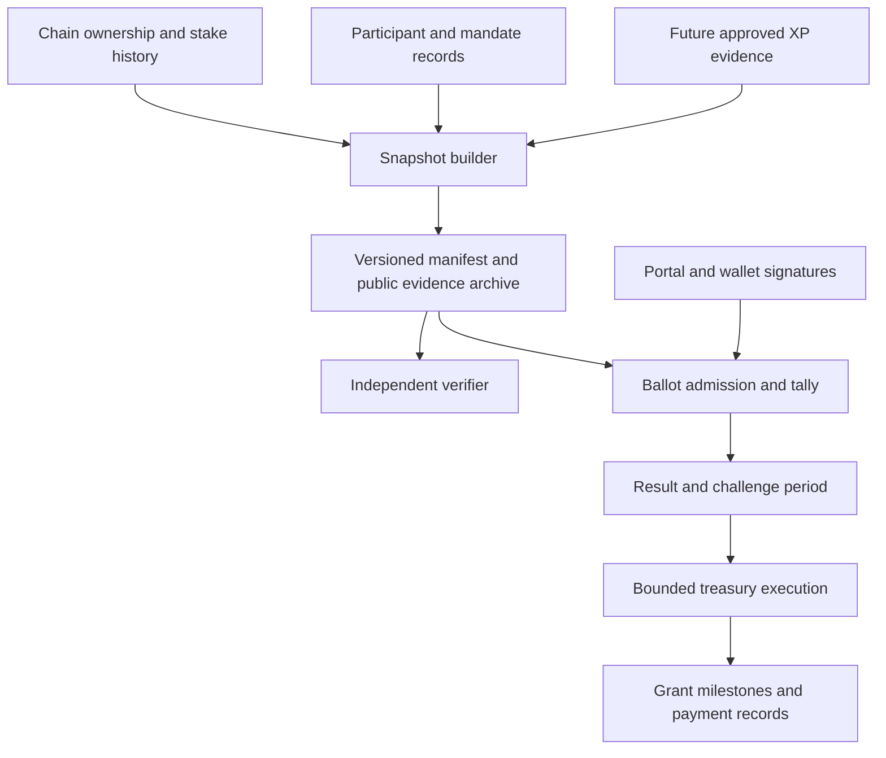

# Realms treasury and grants governance — design draft

Status: design direction accepted, 2026-11-05. An initial [Cairo implementation](../contracts/governance/README.md) now implements treasury ballots, expiring delegation, and bounded payments. It is locally tested and not deployed; the existing portal and Snapshot X space are unchanged. Numerical parameters below remain simulation candidates, not adopted policy.

Implementation boundary: participant identity and historical balances are publisher attestations in this first contract package. Policy is immutable per deployment, ballots are submitted onchain, and the contract directly executes a fixed-token payment after passage and a delay. Production identity/data verification, portal integration, and multi-option quadratic grant rounds remain separate work; see the package README for exact supported behavior and trust assumptions.

## Agreed direction and open decisions

The product should govern treasury and grants first, reuse Snapshot where useful, and combine Realm ownership, veLORDS, and eventually XP into one score. The primary problem is consolidation of power. Delegation should expire, and the weighting should favor broad participation over asset concentration. There is no nominated XP system yet.

The next consequential decision is what counts as a distinct participant. Square-root weighting per wallet rewards wallet splitting. Whether current concentration comes mainly from asset ownership, delegation, or both also remains unmeasured. This draft develops a candidate mechanism without treating those questions as settled.

## First principles

1. Separate economic stake, participation, representation, and authority to spend. A single score can combine signals without making them interchangeable in the underlying records.
2. Measure concentration before claiming to reduce it. A blend can entrench the same holders if they dominate every component.
3. Delegation is renewable consent. Expiry removes forgotten mandates; it does not prevent people from repeatedly choosing the same delegate.
4. Broad support means distinct participants, not transactions or wallet addresses. Repeat ballots must never create additional influence.
5. Every result must be reproducible from fixed rules, input evidence, and accepted ballots.
6. Limit the damage a captured vote can cause through grant budgets, payment milestones, and delayed execution.

## Candidate weighting: diminish holdings before combining them

Let `i` be an eligible participant and `E` the complete eligible participant set at the snapshot:

```text
R_i = eligible Realm count aggregated across participant i's linked wallets
V_i = eligible veLORDS balance aggregated across the same participant
X_i = eligible XP from approved sources and periods

realmShare_i = sqrt(R_i) / sum(j in E, sqrt(R_j))
stakeShare_i = sqrt(V_i) / sum(j in E, sqrt(V_j))
xpShare_i    = sqrt(X_i) / sum(j in E, sqrt(X_j))

W_i = a * realmShare_i + b * stakeShare_i + c * xpShare_i
a + b + c = 1
```

Each component has an explicit share of total eligible influence. Normalize against the eligible population, never only the people who actually vote. Otherwise turnout silently changes the component weights.

For a component whose coefficient is zero, omit its calculation. A positive coefficient with a zero denominator invalidates snapshot publication; it must not silently redistribute that component's influence.

Illustrative scenarios to compare: `60/40/0` while XP is absent, and `50/30/20` after XP becomes verifiable. These numbers express political choices, not technical conclusions. Introducing XP requires a new policy version and advance notice. Do not award invented XP to make an initial formula work.

Use integer fixed-point arithmetic and a specified integer-square-root algorithm. Publish precision and rounding rules and derive quorum from the exact resulting integer supply. The display can rescale the result to convenient voting units.

### What this changes

Consider only the Realm component, with one participant holding 100 Realms and 100 other participants each holding one:

| Rule | Large holder | Other participants combined | Large holder's share |
| --- | ---: | ---: | ---: |
| Linear assets | 100 | 100 | 50% |
| Square root per participant | 10 | 100 | 9.09% |
| Square root per wallet, large holder splits into 100 wallets | 100 | 100 | 50% |

The last row is the central attack, not a peripheral edge case. With fractional assets, the available splitting opportunities can be even greater. Wallet age, minimum balances, and playtime raise costs but do not establish unique people.

### If literal participant count should also matter

Square-root weighting already rewards distributed ownership, but it does not guarantee broad approval. Two alternatives deserve simulation:

- Add an equal-participant component: `finalWeight_i = h / N + (1 - h) * W_i`, where `N` is the fixed eligible participant count. This gives membership an explicit share of influence.
- Keep `W_i` and require a minimum number or fraction of distinct supporters as an additional passage condition. This is easier to explain as a breadth requirement, but can create deadlock.

Both depend on credible participant uniqueness. Neither should count raw wallet addresses. A low-value asset must not automatically create an unlimited number of eligible memberships.

## Identity is part of the mechanism

| Model | Benefit | Limitation |
| --- | --- | --- |
| Permissionless wallets | Simple admission and pseudonymity | Nonlinear weighting can be gamed through splitting; no credible claim of person-level concentration reduction |
| Community-attested participants | Can aggregate wallets before applying diminishing returns | Admission gatekeepers, collusion, exclusion, privacy, and appeals become governance responsibilities |
| External uniqueness credentials | Reuses an existing uniqueness process | Adds provider, accessibility, recovery, and privacy assumptions; coverage needs testing |

Recommendation: explore a pseudonymous participant registry for a capped pilot, while retaining wallet-based access to view, discuss, and submit ideas. This is a proposal, not an agreed identity policy.

Before binding use, define admission evidence, independent attestors, conflicts, admission delay, credential expiry, wallet linking by signatures, recovery, duplicate challenges, and appeals. Freeze participant mappings per ballot. Keep sensitive evidence outside public ballot records; publish only necessary commitments and decisions. Admission authorities must not be able to rewrite an active electorate.

Linking wallets voluntarily does not prove that undisclosed wallets belong to different people. Credentials also do not prevent genuine participants from colluding or selling votes. Organizations, guild treasuries, custodians, and multisigs need explicit eligibility rules: a multisig is not automatically another person with another identity bonus.

If participant uniqueness is rejected, retain the permissionless branch but describe square-root results as experimental. Consider linear entitlement plus expiring delegation and constrained spending rather than claiming a wallet-based quadratic rule solves concentration.

## Two voting behaviors

### Treasury resolutions: square-root-weighted For / Against / Abstain

Use the composite entitlement above for a clearly specified spending decision. Each participant has one effective ballot. This is square-root-weighted governance, rather than a voice-credit allocation exercise.

At proposal creation, fix the eligible supply `S`, participation quorum `q`, minimum supporting weight `y`, approval threshold `t`, and any participant-breadth threshold. A candidate passage rule is:

```text
For + Against + Abstain >= q * S
For >= y * S
For + Against > 0
For / (For + Against) > t
```

Abstain counts toward participation but never as approval. A tie fails. All thresholds require historical turnout simulations; none are chosen in this draft. Delegation expiry and nonparticipation must not reduce `S`. Higher-risk spending and changes to governance rules should require stricter thresholds and longer delays, fixed by policy rather than chosen by the proposer.

### Grant rounds: quadratic voice credits as a later experiment

Classic quadratic voting gives voters credits and charges `votes²` for intensity on each option. A round with several applications creates a meaningful allocation trade-off. This is a different layer from the entitlement calculation. [RadicalxChange explanation](https://www.radicalxchange.org/wiki/quadratic-voting/).

For a pilot, compare equal participant credits against credits derived from the blended score. If a square-root-derived score also funds quadratic credits, the additional concavity is deliberate and must be measured; do not accidentally apply two discounts.

An allocation ballot must satisfy `sum(optionVotes²) <= participantCreditBudget`. Delegates submit allocations on behalf of each represented participant budget, even if the UI offers a shared template. Pooling credits before taking square roots changes the result and penalizes representation.

Initially use these results to prioritize a shortlist. A treasury resolution approves the exact funding package. A ranking alone does not specify payouts: an automatic grant allocator would also need fixed rules for requested amounts, budget exhaustion, ties, minimum support, partial funding, and unspent funds.

## Expiring delegation

Candidate mandate fields: participant, delegate, governance scope, policy version, start time, expiry time, nonce, and authentication evidence. One active delegate per participant per scope; one hop only. Incoming mandates cannot be delegated onward.

Candidate duration: 30 or 90 days, with a 90-day maximum. Renewal requires fresh explicit authorization. No automatic renewal or silent migration from old permanent delegations. Stagger expiry by authorization date to avoid a single community-wide renewal cliff.

Calculate entitlement at the participant level first, then sum represented entitlements. Ten people with one Realm each retain ten units when they select one delegate; applying a square root to the delegate's aggregate holdings would erase that breadth.

Proposed ballot semantics:

1. Fix ownership, identity, weights, and delegation records at the published cutoff.
2. Use a mandate only if it was active at the cutoff and remains valid through the ballot's fixed close time. A mandate expiring during voting is ineligible for that ballot; the participant can vote directly.
3. Renewal or a new delegate after the cutoff affects future ballots. Show this limitation before signing.
4. A participant's direct ballot overrides their delegated ballot for the current proposal, including a direct Abstain. Recompute the represented amount so it never counts twice.
5. Provide a proposal-specific withdrawal of representation that suppresses the delegate without counting as an Abstain. Global revocation stops future mandates; the UI can offer the current-ballot withdrawals alongside it.
6. The latest valid participant action before close determines their direct ballot or withdrawal. A withdrawal remains effective until replaced by a direct ballot; it does not revert to the delegate's choice.
7. Delegates may update their ballot before close. Their last valid ballot applies only to still-represented participants. The final outcome is independent of whether the delegate or participant voted first.

Expiry is a validity rule, not a cron job. A missed reminder cannot prolong authority. If a deadline must move, cancel and reissue under a fresh snapshot rather than extending mandates implicitly.

These semantics require tally support. A custom strategy returning a static voting-power number does not by itself implement direct overrides or withdrawals.

## Other controls against consolidation

- Show delegated and self-owned power separately, plus mandates nearing expiry. A large delegate and a large owner create different risks.
- Give new delegates discoverability through rotating eligible listings, topic filters, participation records, and disclosed conflicts. Avoid treating the largest balance as the default recommendation.
- Measure repeated renewal of the same delegates and concentration of actual cast votes. Expiry with unchanged concentration is an observed failure to diversify, even if technically correct.
- Do not introduce hard per-wallet caps. Any delegate cap needs a grouping rule and a defined disposition for excess mandates; it cannot solve concentrated self-owned entitlement.
- Use round budgets, per-grant ceilings, milestone payments, and a delay before treasury execution. Restrict an emergency guardian to documented, temporary blocking powers, not arbitrary spending or changing results.
- Disclose recipient and reviewer conflicts. Review committees can assess milestone evidence but should not gain unrestricted treasury access. Any recusal rule must define its effect on eligibility and quorum before voting.

## Ownership, veLORDS, and XP evidence

**Realms:** choose the eligible chain and collection, historical cutoff, and treatment of custody, wrapping, bridging, burns, and rentals. Count a canonical Realm once. An L1 escrow balance plus its L2 representation cannot count twice. Prefer a clearly scoped L2 pilot over claiming cross-chain completeness before reconciliation exists.

**veLORDS:** verify the deployed contract's meaning, historical balance availability, lock/decay behavior, transferability, and custody rules. Use the underlying entitlement once; do not add received legacy delegation as another asset. Compare point-in-time exposure with a trailing-window measure to assess temporary acquisition attacks. Time-weighting requires historical evidence and should not be assumed available.

**XP:** source undefined. Keep its coefficient at zero initially. A later source must define qualifying games, seasonal normalization, anti-bot evidence, corrections, appeals, retention, and identity binding. Prefer recent, verifiable achievements over raw lifetime grind. Game activity can correlate with wealth or automation; it is not inherently proof of independence. Buying a character must not silently buy its former player's civic history. Merkle inclusion proves membership in a published dataset, not that the publisher's XP claims are true.

## Infrastructure and trust boundaries



| Component | Responsibility and failure behavior |
| --- | --- |
| Participant registry | Wallet linking, admission, expiry, recovery, appeals; immutable mappings per snapshot |
| Historical indexers | Persist event history and chain checkpoints, handle reorganizations, reconcile canonical assets; current ownership is insufficient |
| Policy registry | Version coefficients, arithmetic, eligibility, mandate semantics, thresholds, and spend limits; active ballots retain their version |
| Snapshot builder | Select finalized chain references under a published cutoff rule; export participant inputs, weights, mandates, total supply, source versions, and hashes |
| Evidence archive | Replicated content-addressed manifests, proposal text, payloads, and ballots; export sufficient data to reproduce every result |
| Ballot service | Domain-separated signatures bound to chain, space, proposal, policy, action, and nonce; smart-account validation, durable receipts, replay prevention, and a documented acceptance deadline |
| Tally engine | Deterministic per-participant resolution, delegation overrides, uniqueness, exact arithmetic, and grant-credit constraints |
| Independent verifier | Rebuild the snapshot and tally separately; reject missing evidence, invalid signatures, duplicate claims, or mismatched totals |
| Execution adapter | Bind the outcome to the exact chain, token, recipient, amount, calldata, and maximum budget; timelock, replay protection, and one-time execution |
| Portal | Explain score sources, who represents the user, mandate eligibility for each ballot, overrides, expiry, pending versus accepted votes, and execution status |
| Operations | Index lag and disagreement alerts, RPC failover, queue health, relayer balances, archive availability, backups and restore drills, and key rotation |

Recommended repo seams: a new pure `packages/governance` module for arithmetic, mandate resolution, policy validation, and deterministic tally; new historical records in `packages/db`; indexer work alongside `packages/apibara`; portal routes and presentational stories in `apps/account-portal`. API replicas can be stateless over Postgres; indexers, snapshot builders, and tally jobs should be independently restartable workers. Keep a CLI verifier usable without the portal or production database.

Publish full source block numbers and hashes. Cross-chain finality and bridge transit need an explicit consistency policy, not an assumption that equal timestamps are an atomic snapshot. Missing or stale evidence prevents opening a ballot. A pre-opening reorganization rebuilds the draft; a canonical-history change after opening triggers the published cancellation process, never a silent weight change.

Signed offchain receipts do not independently prove that an operator admitted every timely vote. A pilot must disclose this censorship and availability trust. Binding use needs an independently verifiable submission log or onchain admission path, a fixed cutoff, and a viable fallback during relayer outages. A tally hash alone does not make an outcome trustless.

## What to reuse from Snapshot

The existing portal already submits Starknet Snapshot X ballots. Snapshot X separates authentication, voting strategies, validation, and execution; reuse compatible pieces after testing the exact deployed implementation. [Snapshot X architecture](https://github.com/snapshot-labs/snapshot-docs/blob/master/snapshot-x/protocol/overview.md).

Snapshot's offchain voting types include weighted, approval, ranked-choice, and quadratic options. Availability there does not establish compatibility with the portal's current Snapshot X space. [Voting types](https://docs.snapshot.box/proposals/voting-types).

The upstream monorepo includes a Vue frontend, governance APIs, relaying, and an SDK. Retain this repo's React portal and integrate only useful services or libraries. Pin versions and record licenses and audit coverage for selected modules. [Snapshot monorepo](https://github.com/snapshot-labs/sx-monorepo).

Compatibility spike: prove expiry-at-close eligibility, per-participant aggregation, direct override in either voting order, withdrawal, revoting, account signatures, and immutable proposal policy. If the selected protocol cannot express them, use a custom tally for the pilot and design the required contract or verified-result adapter before binding execution. Do not market custom offchain rules as enforced by an unchanged Snapshot X contract.

## Repository findings

- [`use-delegate-realms.ts`](../apps/account-portal/src/hooks/governance/use-delegate-realms.ts) calls `delegate(delegatee)` with no expiry parameter.
- [`use-voting-power.ts`](../apps/account-portal/src/hooks/governance/use-voting-power.ts) reads live `get_votes`; that is not the proposed historical, identity-aggregated score.
- [`use-vote-proposal.ts`](../apps/account-portal/src/hooks/governance/use-vote-proposal.ts) submits `authenticate_vote` with Against / For / Abstain and proposal strategy indices.
- [`realm-ownership.ts`](../packages/db/src/schema/realm-ownership.ts) stores current ownership and index progress. A governance snapshot requires historical reconstruction or archived checkpoint evidence.
- [`strk-delegates.indexer.ts`](../packages/apibara/indexers/strk-delegates.indexer.ts) is commented out in this checkout; establish the actual source of delegate records before relying on it.
- No authoritative XP ledger was found in the inspected application and package sources. Existing veLORDS analytics are not proof that the required historical governance entitlement is available.

These are code observations, not a verification of deployed contracts, production data, or treasury permissions.

## Rollout and acceptance criteria

1. **Baseline and simulation:** obtain historical ownership, stake, delegation, and turnout. Compare linear and square-root blends, several coefficients, missing-XP scenarios, and explicit wallet-splitting attacks. Measure top-1/5/10 shares, HHI (`sum(share²)`), effective participant count (`1/HHI`), minimum winning coalition, source overlap, and actual versus eligible influence. Show address-level and known-entity-level results separately; unknown common control remains a limitation.
2. **Identity and policy decision:** choose the participant model and document admission, organizational membership, recovery, and appeals. Ratify the eligibility and budget policy before binding use. If identity is unresolved, simulations remain demonstrations.
3. **Shadow ballots:** implement snapshots, short mandates, signatures, verifier, and UI with no spending authority. Compare outcomes against existing governance. Historical outcome comparisons are counterfactuals because users may behave differently under new rules.
4. **Capped grants pilot:** publish the budget and execution trust model. Existing authorized treasury signers execute only the approved payload after a challenge window. This is explicitly signer-enforced execution; they can still censor or deviate. Record every approval and payment.
5. **Binding execution:** require contract tests, independent review, end-to-end rehearsal, and demonstrated input and tally verification. Configure delayed upgrades and emergency cancellation. Migration requires fresh delegation consent; old proposals finish under their old rules.

Minimum adversarial cases: one owner splits wallets; linked wallets merge; multiple delegates share an operator; a delegate votes before and after a direct override; mandate expires at the exact cutoff or close; withdrawal and revote race; assets transfer after snapshot; the same Realm appears on two chains; XP is corrected; an indexer reorganizes; a relayer omits a vote; a signature is replayed across proposals; the same transaction executes twice; a grant round exceeds its budget; a zero-supply component appears.

Before launch, independently reproduce at least one complete snapshot and tally, prove each entitlement counts at most once, prove all grant allocations satisfy their credit budgets, restore the archive from backup, and demonstrate that failed evidence or unresolved challenges prevent execution. Confirm the measured concentration improvement survives plausible splitting and collusion assumptions. Passing a build is not evidence that a governance mechanism meets these conditions.
